

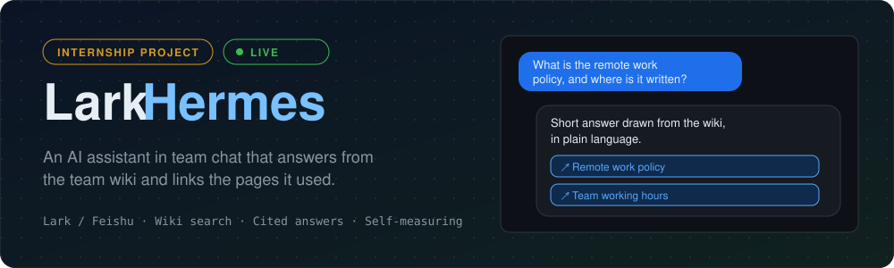

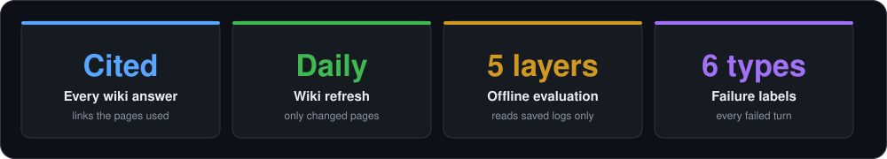

## Contents

[At a glance](#at-a-glance) · [What it does](#what-it-does) · [Screenshots](#screenshots) · [How a question is handled](#how-a-question-is-handled) · [Architecture](#architecture) · [Keeping answers current](#keeping-answers-current) · [Quality](#quality) · [Design choices](#design-choices) · [Roadmap](#roadmap) · [License](#license)

---

## At a glance

| | |
|---|---|
| **Problem** | Team knowledge sits in a wiki that is slow to search and easy to misremember. |
| **Solution** | An assistant in Lark/Feishu chat that searches the wiki and answers with links to its sources. |
| **Quality** | It measures itself: every failed answer gets a root cause. |
| **Status** | Live and in daily use. I built it and I operate it. |

> [!NOTE]
> This is an internship project. The overview is deliberately general: no deployment details, credentials or internal content.

## What it does

Ask in chat, get the answer and the wiki pages behind it, in a private message.

| | |
|---|---|
| 🔗 **Verifiable** | Links are copied exactly from the wiki. If a link can't be copied accurately, it is left out. |
| 📚 **Grounded** | The wiki wins over public sources. If two pages disagree, both are shown. |
| 🔒 **Private** | Answers arrive as a direct message. |

## Screenshots

> [!NOTE]
> Illustrative mockups with sample content, not real captures. The wiki links use a placeholder domain.

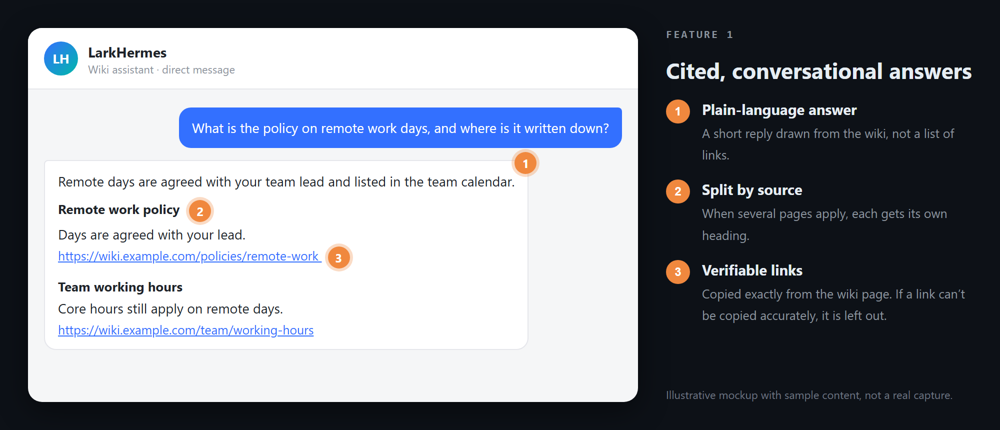

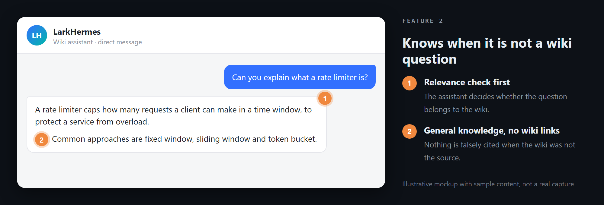

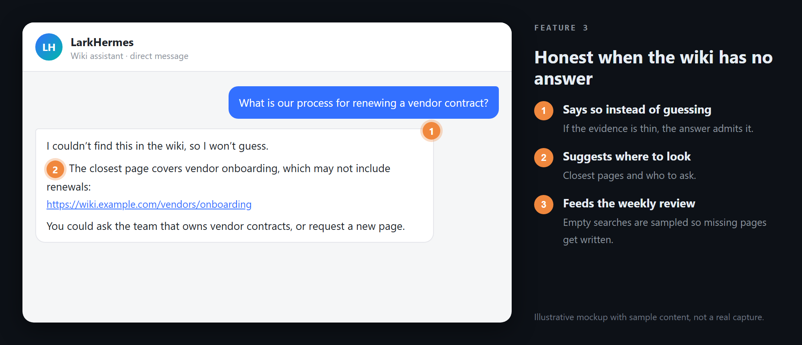

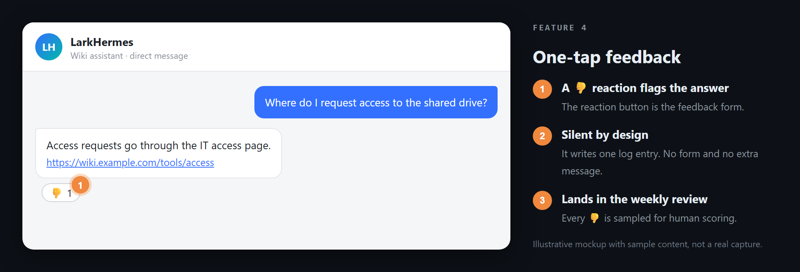

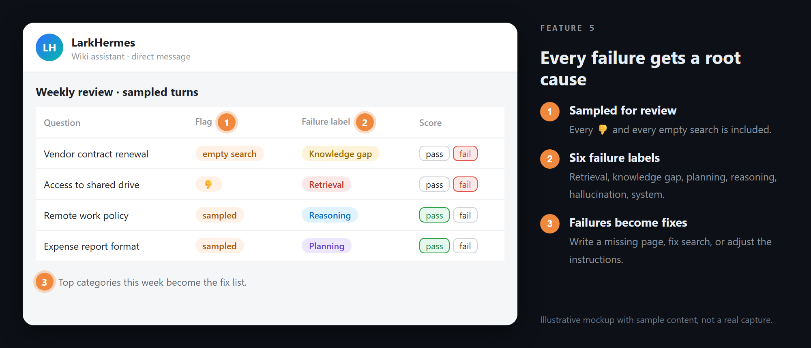

## How a question is handled

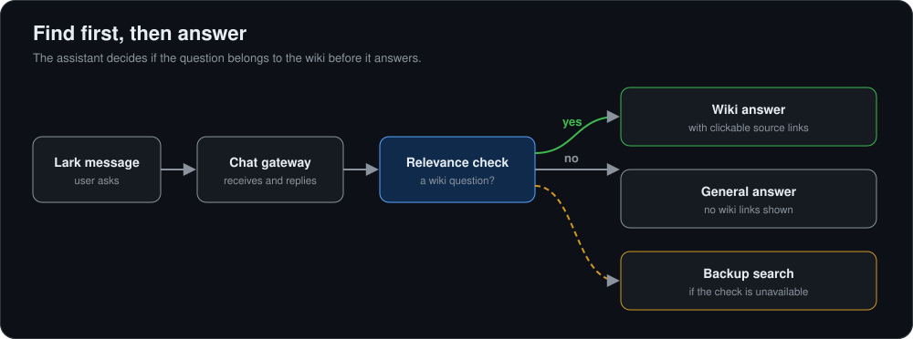

- **Wiki question:** answer from the pages found, with source links.
- **Not a wiki question:** answer from general knowledge, with no wiki links.
- **Relevance check unavailable:** a keyword search takes over.

## Architecture

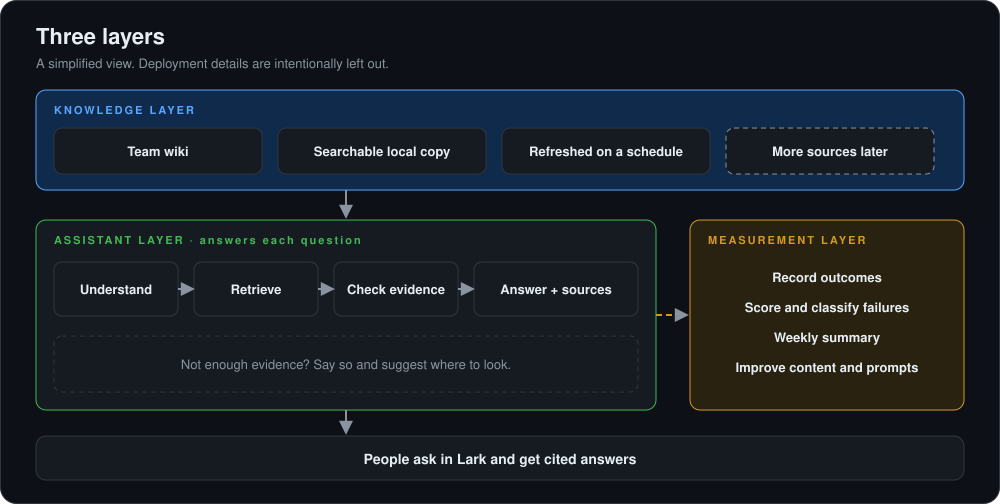

| Layer | Role |
|---|---|
| **Answering** | Runs on every question: find pages, check the evidence, write a short answer with sources. |
| **Measuring** | Runs separately and read-only, so it can be added or removed without touching the live assistant. |

## Keeping answers current

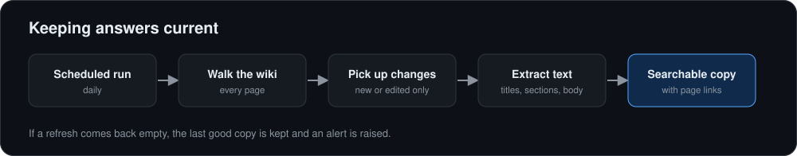

- **Fast:** search runs on the local copy, not the live wiki.
- **Safe on failure:** an empty refresh keeps the last good copy.

## Quality

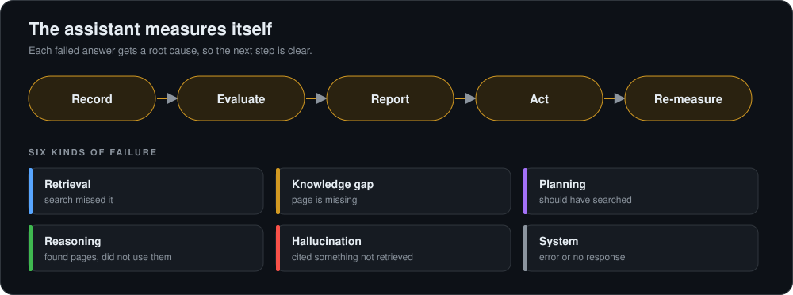

**Five layers of offline evaluation.** They read the saved conversation log only, so the live assistant carries no extra code.

| Layer | What it gives |
|---|---|
| 1 · **Turns** | Every query, search, retrieved page and response time as structured records |
| 2 · **Metrics** | Citation rate and response time, week over week |
| 3 · **Human review** | A weekly scoring screen. Samples include every 👎 and every empty search |
| 4 · **Failures and benchmark** | A failure label on every turn, plus a fixed question set for before-and-after checks |
| 5 · **Fix list** | The week's top failure categories linked to concrete fixes |

**Feedback is one reaction.** A 👎 flags an answer for review. No form.

## Design choices

| Choice | Why |
|---|---|
| **Configured, not hand-coded** | A declarative agent profile on a native chat gateway. It replaced an earlier hand-built bot after several rewrites. |
| **Search and writing are separate** | One step picks the pages, the model only writes the answer. Easy to debug and benchmark. No vector database needed. |
| **Users shaped the format** | The team rejected plain link dumps, so answers are conversational with sources. |
| **A quality loop, not ship and drift** | A regression benchmark, a label on every failure and a weekly review. |
| **Wiki is the source of truth** | General knowledge is a fallback, and the answer must say so. |
| **Degrades gracefully** | If a component is down, it falls back to a simpler path instead of failing silently. |

## Roadmap

| Next | |
|---|---|
| **Memory** | Remember context per person. Spot the questions asked most and answered least. |
| **Multi-step help** | Follow a procedure across pages. Draft update requests for missing content, with a person approving. |
| **More sources** | Refresh when pages change. Connect other team systems for live answers. |

## License

Apache-2.0. See [LICENSE](LICENSE).
